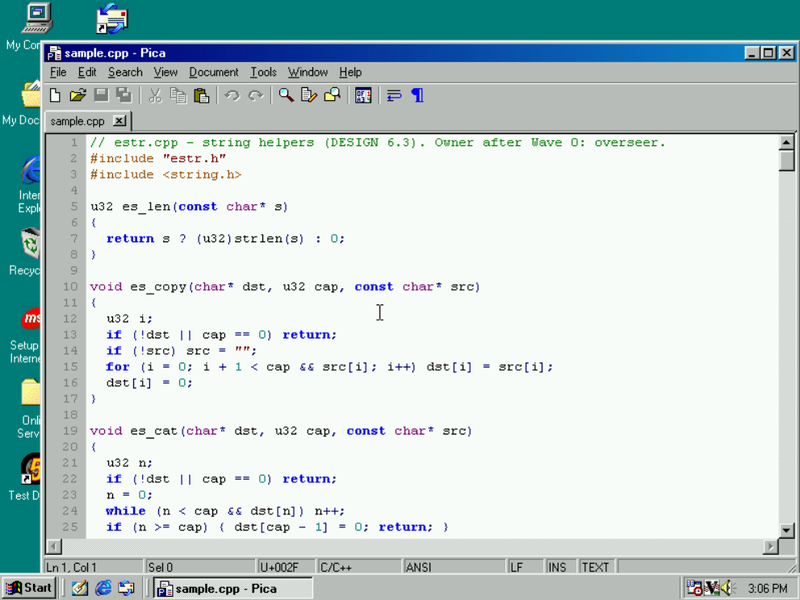
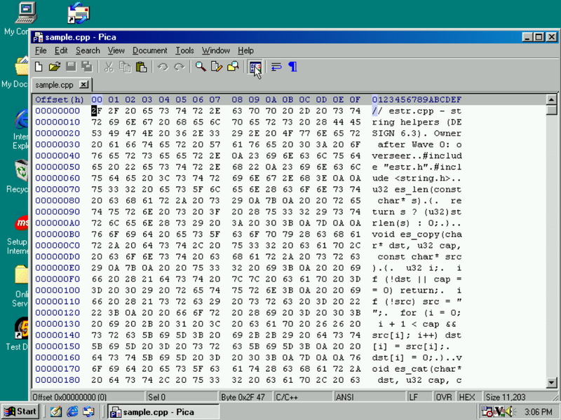
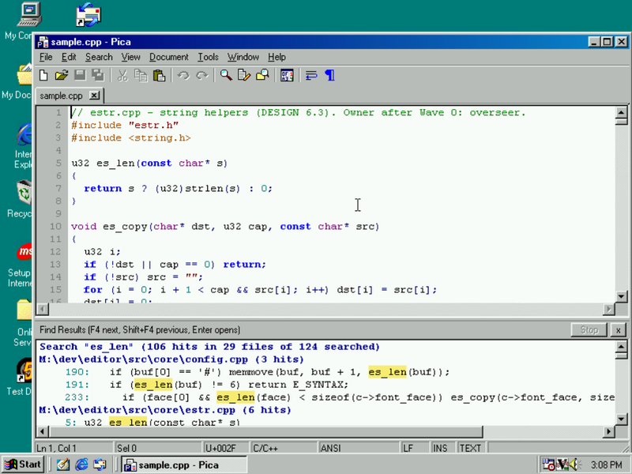
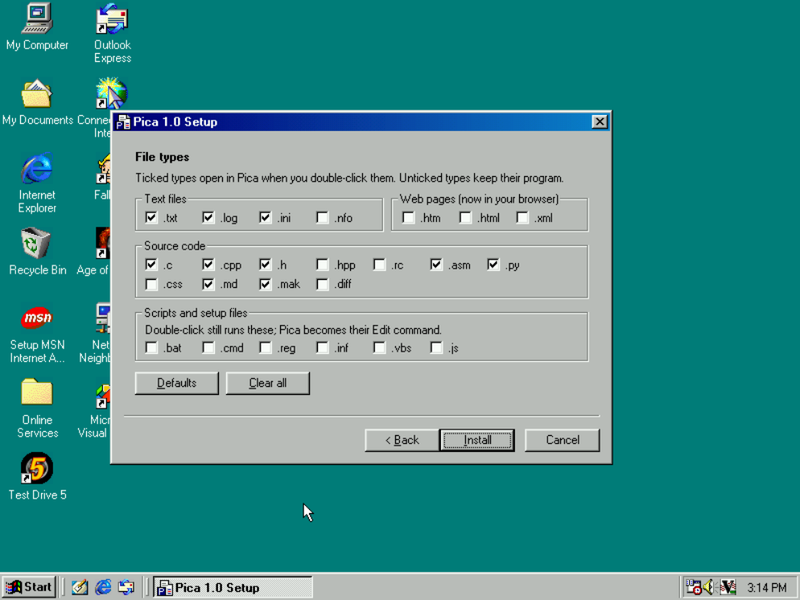
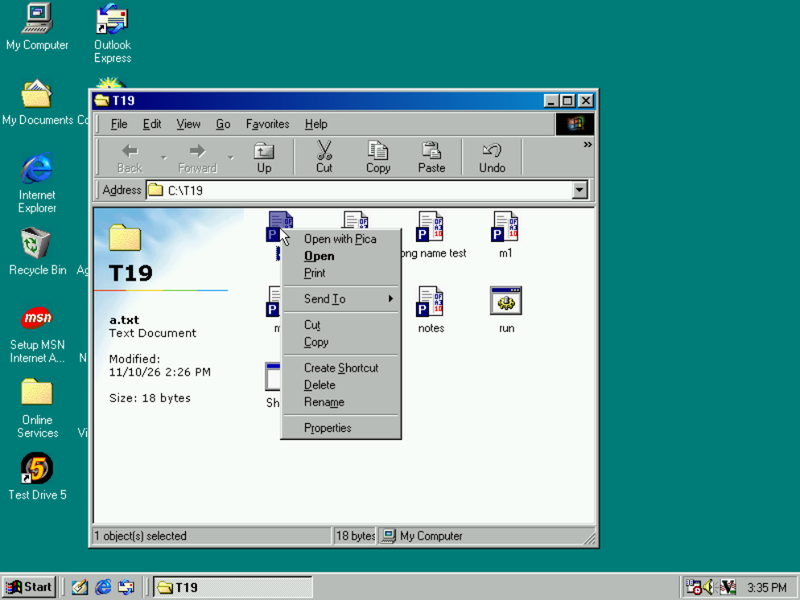

# Pica

A text editor and hex editor in one, for **Windows 98**. Written in C++ for **Visual C++ 6.0** and built inside
Windows 98 itself.

Pica opens every file in a tab and shows it either as text with syntax colouring or as bytes in a hex view. Both
views edit the same document with one undo history, and switching between them never changes a single byte. Saves
can't leave a half-written file, unsaved work is backed up while you type, and after a crash or a power cut the next
start brings your tabs back. It feels like Notepad++ and behaves like a well-made Win98 program: standard controls,
system colours, menus with accelerators and VC6-style keys.



| | |
|---|---|
|  |  |
| The same file in the hex view: offsets, bytes, characters | Find in Files: 106 hits in 29 files, F4 walks through them |
|  |  |
| Setup: pick the file types that open in Pica | "Open with Pica" on every file; .txt keeps its name and Print |

**Download:** `pica-1.0-setup.exe` (installer) or `pica-1.0.zip` (portable), version 1.0.

## Features

- **Tabs**: drag to reorder, middle-click to close, right-click for Close Others, Copy Full Path and Open Containing
  Folder. 10 recent files, drag-and-drop, single instance (files opened from Explorer become tabs in the running Pica).
- **Syntax colouring** for C/C++, resource scripts, makefiles, batch files, INI, assembly, Python, HTML, JavaScript, CSS,
  XML, Markdown and diffs, picked by extension. Add or change languages with `.lng` files.
- **Encodings**: ANSI, OEM (DOS), UTF-8 with or without BOM, UTF-16 LE/BE, plus Windows-1250/1251/1253/1254/1257,
  OEM 437/850/852/866 and KOI8-R under Reload as. Converting warns before anything is lost. Line endings CRLF / LF / CR;
  mixed files keep each line as it is. Bytes that aren't valid text survive load, edit and save unchanged.
- **Hex view** of the same document: overwrite (default) and insert, nibble caret, Tab between the hex and character
  panes, changed bytes in red until saved, byte-pattern search (`DE AD ?? EF`), go to offset (`1F40`, `#8000`,
  `end-10`, `50%`), a data inspector (int8 to double, little or big endian). Binary files open in the hex view.
- **Search**: Normal, Extended (`\n \t \xHH`) and Regex modes; our own regex engine with groups, backreferences,
  lookahead and `\U \L \u \l` case changes in replacements. Whole word, in selection, Count, Find All, Mark All,
  Replace All (one undo step), Replace All in Open Tabs, incremental search (Ctrl+I), Find in Files with masks
  (`*.cpp;*.h;!*.bak`) on a worker thread.
- **Editing**: unlimited undo/redo grouped by typing runs, auto-indent, block indent, tabs or spaces per language, word
  wrap, show whitespace and line endings, brace matching (Ctrl+B), bookmarks, go to line, line commands (Ctrl+D,
  Ctrl+L, Ctrl+Shift+Up/Down, Ctrl+Q), UPPER/lower case.
- **Never lose data**: saves go to a temporary file that is checked before it replaces yours (optional `.bak` copy).
  Unsaved changes are backed up a few seconds after you stop typing; the session is written in two alternating files,
  so a crash at any moment leaves a valid copy. Files changed by another program reload by themselves, or ask if you
  have edited them.
- **Large files**: up to 16 MB in memory, up to 4 GB read on demand while you scroll (the first screen and the hex
  view appear at once while Pica counts the lines). Megabyte-long lines stay responsive.
- **Fast on a Pentium II 233**: a keystroke takes about 1 ms to redraw, a full repaint 6 ms, opening a 10 MB file
  0.4 s, and Pica starts in 0.2 s (`pica.exe -bench`, numbers in `docs/HANDOFF.md`, T17).
- **Options** in a property sheet (General, Editor, Files, Colours, Hex), every option with a one-line explanation.
  F1 opens the keyboard shortcuts and a regex cheat sheet as a searchable read-only tab.

## Requirements

- Windows 98 or 98 SE (tested on 98 SE; other Windows versions are untested)
- A Pentium-class PC; tuned on a Pentium II 233 MHz with 128 MB RAM
- About 1 MB of disk space

## Install

There are two ways; both install the same `pica.exe`.

### Setup (`pica-1.0-setup.exe`)

Our own installer, a classic Win98 wizard:

- **Folder**: `C:\Program Files\Pica` by default.
- **Options**: Start menu shortcut (on), desktop shortcut (off), "Open with Pica" in the right-click menu of every
  file (on).
- **File types**: a ticked type opens in Pica on double-click. Ticked by default: `.txt .log .ini .c .cpp .h .asm .py
  .md .mak`; also offered: `.nfo .hpp .rc .css .diff` and the web types `.htm .html .xml`. Explorer keeps each type's
  name ("Text Document"), its other commands such as Print, and the New menu. Scripts and setup files
  (`.bat .cmd .reg .inf .vbs .js`) still run on double-click; Pica becomes their **Edit** command.
- Setup remembers the previous associations and restores them on uninstall (only those that still point at Pica).

**Upgrades**: run the newer setup. It finds the installed copy, says "Upgrade Pica 1.0 -> 1.x", keeps the folder and
your earlier choices, and replaces only the program files. It never touches `pica.ini`, the session, backups,
`langs\` or anything else you put in the folder. If Pica is running, Setup asks you to close it and offers Retry; it
never kills Pica, so the session and backups get written. A file in use is replaced at the next restart
(`WININIT.INI`). The same version again repairs the install; an older setup over a newer Pica asks first.

**Uninstall**: Add/Remove Programs > Pica 1.0, or `uninst.exe` in the Pica folder. It asks whether to delete your
settings, session and backups too (default: keep them).

**Silent switches**:

| Switch | Meaning |
|---|---|
| `/S` | silent install with the defaults (or the installed copy's choices) |
| `/D=<folder>` | install folder; must be the last switch, no quotes needed |
| `/TYPES=default\|none\|all\|.txt,.c\|+.bat,-.ini` | file types: a set, or changes to it |
| `/STARTMENU=0\|1`, `/DESKTOP=0\|1`, `/CONTEXT=0\|1` | the three options |
| `/RUN` | start Pica when done |
| `/LOG=<file>` | log every file and registry change (default `%TEMP%\PICASET.LOG`) |
| `/UNINSTALL [/S] [/PURGE]` | uninstall; `/PURGE` also deletes settings, session and backups |
| `/FORCE` | allow a silent downgrade |

Exit codes: 0 ok, 1 error or cancelled, 2 Pica is running, 3 restart needed, 4 a newer version is installed. Registry
keys and the details are in [docs/INSTALLER.md](docs/INSTALLER.md).

### Portable (`pica-1.0.zip`)

Unzip it to `C:\` (you get `C:\PICA`) or anywhere else and run `pica.exe`. Nothing goes into the registry; to
uninstall, delete the folder. To upgrade, unzip the new version over the old one: the zip holds no settings, so yours
stay. Without Setup there are no associations, but you can drop files on the window or onto `pica.exe`.

## Where settings, session and backups live

Pica uses one settings folder:

1. the folder of `pica.exe`, if Pica can write there (on Windows 98 that includes `C:\PICA` and
   `C:\Program Files\Pica`);
2. otherwise `C:\WINDOWS\Application Data\Pica`;
3. or the folder given with `-cfg <folder>`.

| File | Contents |
|---|---|
| `pica.ini` | settings, window position, recent files, search history |
| `session1.ini`, `session2.ini` | open tabs, carets, scroll positions, bookmarks (written alternately) |
| `backup\T*.BAK` | unsaved changes of modified tabs (deleted once the tab is saved) |
| `Pica Help.md` | the help text, written when you open Help |
| `langs\*.lng` | your own syntax files (optional; next to `pica.exe` or in the settings folder) |

Help > About Pica shows the folder in use.

## Command line

```
pica.exe [-n<line>] [-hex] [-ro] [-multi] [-nosession] [-cfg <folder>] [files...]
```

| Option | Meaning |
|---|---|
| `-n120` | go to line 120 in the next file |
| `-hex` | open the next file in the hex view |
| `-ro` | open the next file read-only |
| `-multi` | start a separate Pica (normally the files go to the running one) |
| `-nosession` | don't restore or save the session |
| `-cfg <folder>` | use another settings folder |

For development: `-selftest [names]` (GUI self-tests, writes `selftest.log` in the settings folder), `-bench`
(performance report `bench.txt`), `-log <file>`.

## Known limits

- **Not in 1.0**: printing, macros, plugins, split view, column selection, folding, autocomplete, replace in files,
  compare, key remapping, user-defined languages beyond `.lng` files, reopen closed tab, zoom, proportional fonts,
  right-to-left and complex scripts. The rough 1.1 order is in `docs/DESIGN.md` 1.4 (a run-tool with jump to error
  comes first).
- **Fonts**: fixed-width only (Courier New 10 pt by default). Characters no installed font can draw show as a grey `?`
  cell; the bytes are untouched. IME input is best effort and untested (no DBCS code page on the test machine).
- **Files over 16 MB** are read on demand: their unsaved changes are not backed up, their encoding can't be converted,
  and editing starts once the lines are counted (about 15 s for 100 MB on the emulated disk; reading and the hex view
  work meanwhile).
- **Files of 8 MB or more** open without colouring and word wrap (Document > Syntax turns colouring back on). Only the
  first 16,384 characters of a line are coloured.
- **Regex**: no lookbehind, atomic groups, possessive quantifiers, named groups, recursion or `\p{...}`;
  backreferences and lookahead see the current line plus up to 64 KB after it.
- **Hex view**: 16 bytes per row, hex offsets, read-only data inspector.
- Undo of a Replace All with thousands of matches takes about a second without a progress window.
- **Setup**: the folder can't be changed on an upgrade (uninstall first); a file replaced at restart comes back as
  `PICA.EXE` in capitals; the verbs copied from the old file type are a snapshot taken at install time.

## Building

Pica is pre-standard C++ in the **VC6 dialect** (no STL, no exceptions, no RTTI, Win98 APIs only). In a Windows 98
command prompt with VC6's environment (`VCVARS32.BAT`):

```bat
nmake                rem pica.exe (objects in obj\), /W3 with zero warnings
nmake test           rem coretest.exe: every core suite, run against C:\PICATEST\tmp
nmake release        rem clean rebuild, then release\Pica-1.0\ = pica.exe + README.TXT
nmake clean
cd setup
nmake clean
nmake                rem setup\setup.exe, embeds ..\pica.exe and ..\README.TXT
```

In our setup the source lives on a Mac and is shared to an 86Box VM as drive `M:`; a small remote-control agent runs
the builds (`w98 build editor release`, `w98 build 'editor\setup'`), and `tools/mkzip.sh` makes
`release/pica-1.0.zip` and `release/pica-1.0-setup.exe` on the Mac (it checks that the setup embeds exactly the
released `pica.exe` and `README.TXT`).

### Testing on the Mac

Everything that isn't Windows (buffer, undo, codecs, detection, layout, lexers, regex, search, hex formatting, editing
commands, INI/config/session, file operations over an abstract file system) lives in `src/core/` and also builds
with clang as strict C++98:

```sh
make -C tests            # lint + every suite, strict build and ASan/UBSan build (189,780 checks)
make -C tests regex      # one suite
make -C tests mac        # extras: parser fuzzer, regex differential fuzzer
```

The same suites run on VC6 as `coretest.exe` (same check counts plus the Win32-only ones). The Windows layer is
checked by `pica.exe -selftest -cfg C:\PICATEST`: 13 GUI test groups with injected keys and answered dialogs, about
3 minutes on the VM. `python3 tools/lint.py` checks the VC6 dialect rules.

## Documentation

- `docs/DESIGN.md`: the spec (architecture, interfaces, document model, rendering, search, files, budgets)
- `docs/TASKS.md`, `docs/HANDOFF.md`: the task waves and each task's notes, tests and bench numbers
- `docs/INSTALLER.md`: Setup's behaviour, switches and registry keys
- `docs/research/`, `probe/RESULTS.md`: the research and the GDI/file I/O probe that shaped the design
- `src/help/help.md`: the in-app help

## All our own code

There is no Scintilla and no other editing component inside: the piece-tree buffer, undo, Unicode tables and codecs,
encoding detection, layout and rendering (`ExtTextOutW` straight to the window), the lexers, the regular expression
engine (a Pike VM plus a bounded backtracker), find in files, the hex view, crash-safe saving, backups and session
restore, and the installer were all written for Pica, about 45,000 lines of C++ plus 17,000 lines of tests. The only
things it links against are VC6's C runtime and Windows 98's own DLLs. The Unicode property and code page tables are
generated from Python's `unicodedata` and `codecs` modules by scripts in `tools/` (the output is committed).

"Pica" is the typewriter pitch of 10 characters per inch, the classic monospace size.

Designed and directed by Henri Lavikainen; developed with Claude (Anthropic) coding agents, 2026.
